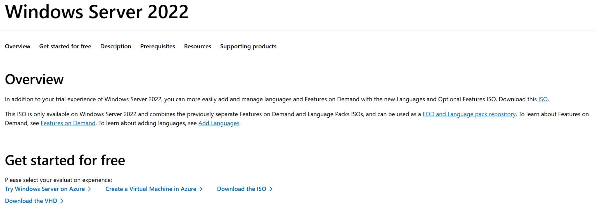

# Lab 03: Downloading Windows Server 2022 ISO

## Objective

Download the Windows Server 2022 ISO installation image from the official Microsoft Evaluation Center. This ISO will be used to deploy a Windows Server 2022 virtual machine in VMware Workstation Pro as part of an Active Directory and Group Policy home lab.

## Lab Environment

| Component | Technology |
|---|---|
| Virtualization Platform | VMware Workstation Pro |
| Server Operating System | Windows Server 2022 |
| Client Operating System | Windows 11 |
| Installation Media | Windows Server 2022 64-bit ISO |
| Download Source | Microsoft Evaluation Center |

## Step 1: Download Windows Server 2022

1. Open a web browser and navigate to the [Microsoft Windows Server 2022 Evaluation Center](https://www.microsoft.com/en-us/evalcenter/evaluate-windows-server-2022).
2. Locate the **Get started for free** section.
3. Select **Download the ISO** to obtain the Windows Server 2022 installation image.
4. Complete the registration form if prompted.
5. Select the appropriate language and begin downloading the 64-bit ISO file.
6. Save the ISO file to a designated folder for the virtual lab.

**Screenshot 1: Microsoft Evaluation Center**

*Figure 1: Official Microsoft Evaluation Center page used to obtain the Windows Server 2022 ISO.*

## Technical Explanation

An ISO file is a disk image containing the files required to install an operating system. VMware Workstation Pro can mount the ISO as a virtual DVD drive, allowing Windows Server 2022 to be installed without physical installation media.

Windows Server 2022 will serve as the foundation for the lab's Active Directory infrastructure. Future configurations will include Active Directory Domain Services (AD DS), DNS, Group Policy, organizational units, user accounts, and security groups.

## Verification

After the download completes, verify that:

- The Windows Server 2022 ISO file exists in the designated download folder.
- The file has the `.iso` extension.
- The download completed without errors.

## Skills Demonstrated

- Windows Server deployment preparation
- Operating system installation media management
- Virtual infrastructure planning
- Enterprise lab environment preparation

## Next Step

Create a Windows Server 2022 virtual machine and a Windows 11 virtual machine using VMware Workstation Pro and attach the downloaded ISO as installation media.
